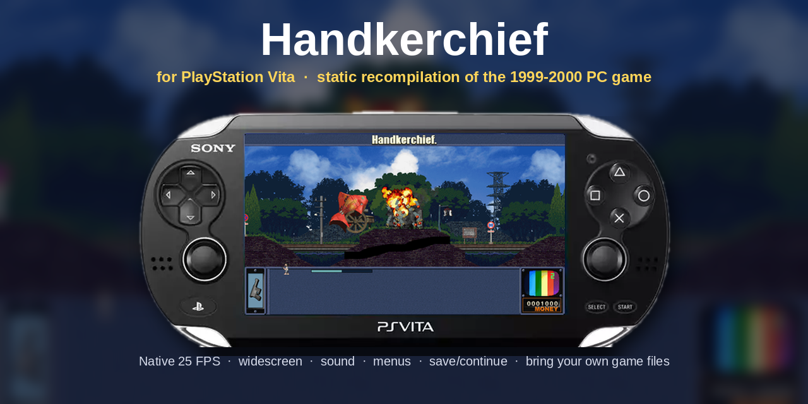
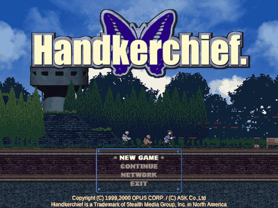

# Handkerchief for PlayStation Vita



An unofficial, non-commercial port of the Windows game *Handkerchief* (OPUS Corp. / ASK Co., Ltd., 1999-2000) to the PlayStation Vita. The original executable is statically recompiled from x86 to C, so the game's own code runs unchanged; the port supplies the Windows environment it expects. **You need your own copy of the game.**

<p align="center"></p>

Screenshots are captured from the port running the original game data. The game's artwork belongs to its rights holders.

> **25 FPS is the original game's speed, not a performance limit.** *Handkerchief* was designed to update and draw exactly 25 frames per second, and all of its movement, animation and timing depend on that rate.

## Status

Work in progress. Tested on a PS Vita 1000 (firmware 3.65, HENkaku) and on Linux.

| Area | State |
| --- | --- |
| Intro, title, stages | Running at the native 25 FPS in 4:3. Every territory's areas load; area and territory transitions tested. A full playthrough has not been confirmed yet |
| Graphics | DirectDraw 8-bit emulated in software; 4:3, stretched 16:9, or **native widescreen** (848x480, more of the world visible; experimental, may run below 25 FPS) |
| Sound | Music and effects through a software mixer with fixed volumes; separate music and effects levels |
| Menus | The game's own menus and dialogs (save/load slots, game and key configuration, exit) drawn over the game and driven by the pad; on-screen keyboard for save names |
| Save / continue | Works |
| Extras | Pause screen with FPS counter, display options, volume, and the game's hidden cheats |

## Installing on the PS Vita

1. Build the VPK (below) and install it with VitaShell.
2. Copy your game files to `ux0:data/handkerchief/`: `HDKWIN.EXE`, `BITMAP/`, `SYSTEM/`, `USER/` and `WAV/`.
3. Start *Handkerchief* from the LiveArea. A log is written to `ux0:data/handkerchief/hklog.txt`.

## Controls (PS Vita)

| Button | Action |
| --- | --- |
| D-pad / left stick | Move. Down: lie down (press again or another direction to get up) |
| Cross | Shoot; confirm in menus |
| Square | Jump |
| Circle / Triangle | Turncoat bomb / switch and rotation (game actions) |
| L / R | Shift / Ctrl (game actions) |
| Select | The game's menu: save, load, stop, exit, configuration |
| Start | Pause screen: display options, widescreen, FPS counter, volume, cheats |

## Building

Requirements: Python 3 with `capstone` and `pefile`, a C compiler and SDL2 for the Linux build, [VitaSDK](https://vitasdk.org) with SDL2 for the Vita build, and Ghidra (headless) to export the function list once. The generated C and every binary built from it are derived from the commercial executable: keep them local and never redistribute them.

```sh
# 1. function list (once) and C generation from your HDKWIN.EXE in original-data/
build/venv/bin/python -I recomp/x86rec.py && build/venv/bin/python -I recomp/gen_import_stubs.py
# 2. Linux build: run it with the game folder as argument
make -f port/Makefile.pc -j8 && build/hk-pc/handkerchief /path/to/game
# 3. PS Vita VPK
cmake -S port/vita -B build/hk-vita -DCMAKE_BUILD_TYPE=Release && cmake --build build/hk-vita -j8
```

See [docs/static-recomp.md](docs/static-recomp.md) for the recompiler and the runtime design.

## How it works

- `recomp/`: the x86 to C static recompiler (derived from [sh3vita](https://github.com/matfsouza/sh3vita)) and the data patches and hooks the port needs.
- `port/rt`: guest memory, CPU state and the native runtime.
- `port/win32`: the Win32 API subset the game uses (files, timers, messages, registry, threads).
- `port/hk`: DirectDraw, GDI text, DirectSound, the dialog and menu system, and the widescreen hooks.
- `port/pc` and `port/vita`: the platform entry points (SDL2).

Technical documentation: [static recompilation](docs/static-recomp.md), [engine map](docs/engine-map.md), [HDK data format](docs/hdk-format.md), [save and stages](docs/save-and-stages.md), [widescreen](docs/widescreen-plan.md).

## How this port was made

This project was built with the help of AI. The recompiler, the runtime and the Windows/DirectX emulation were written with an AI coding assistant ([Claude Code](https://claude.com/claude-code) by Anthropic). The project owner directed the work, decided what to build and tested every build on a real PS Vita. AI-written changes were checked against the original game's behaviour with logs, screenshots and measurements on PC and on the console before being kept.

## License

GPL-3.0 (see [LICENSE](LICENSE)). Third-party components and their licences are listed in [THIRD_PARTY_NOTICES.md](THIRD_PARTY_NOTICES.md). *Handkerchief* is a trademark of its respective owners; this project is not affiliated with them and distributes no game data.
